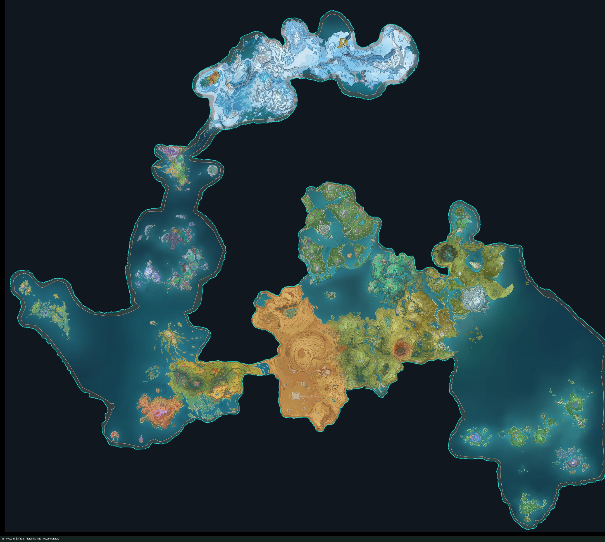

# テイワットマップ画像

ChatGPTで地形を参照するための、公式地図の全体図と地域別画像です。© HoYoverse。公式の地形画像を参照用に結合しています。

[全体図](teyvat-overview.jpg)

| 地域 | 画像 |
|---|---|
| モンド | [画像](mondstadt.jpg) |
| 璃月 | [画像](liyue.jpg) |
| 稲妻 | [画像](inazuma.jpg) |
| スメール | [画像](sumeru.jpg) |
| フォンテーヌ | [画像](fontaine.jpg) |
| ナタ | [画像](natlan.jpg) |
| ナド・クライ | [画像](nod-krai.jpg) |
| スネージナヤ | [画像](snezhnaya.jpg) |

ChatGPTへは対象画像のGitHubリンクを渡してください。画像を参照できない場合は、その画像をダウンロードして会話に添付できます。

地形の画像にはゲーム内の高度、通行可能な入口、地下階層の対応がすべて含まれているわけではありません。通行可否は既存の設計資料と合わせて確認してください。

取得元は [HoYoLAB公式テイワットマップ](https://act.hoyolab.com/ys/app/interactive-map/index.html) です。地図版と各画像の座標範囲・SHA-256は [manifest.json](manifest.json) に記録しています。著作権はHoYoverseに帰属します。
